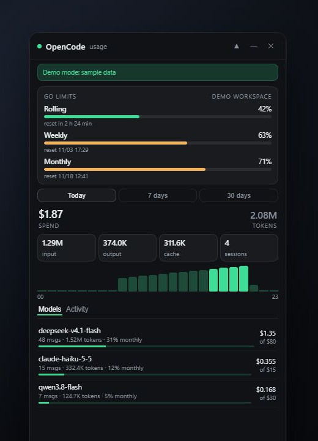
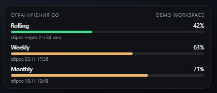

# OpenCode Monitor

**English** · [Русский](README.ru.md)

An unofficial desktop overlay for [OpenCode](https://opencode.ai) that shows Go plan limits, spend, tokens and recent activity — always on top, always local.



> Not affiliated with, endorsed by, or supported by OpenCode. It reads the local OpenCode database and the local CLI; it does not use any private API.

[](https://github.com/Niki0zz/opencode-monitor/actions/workflows/ci.yml)
[](LICENSE)
[](#requirements)

## Features

- **Go limits** — rolling (5 h), weekly and monthly percentages with reset times, read from the local OpenCode CLI.
- **Spend** — real cost when OpenCode records it, otherwise an estimate from the editable price table in [`lib/pricing.json`](lib/pricing.json).
- **Tokens** — input, output, reasoning and cache reads, plus session count.
- **Chart** — token activity by hour for today, or by day for 7/30 days.
- **Models** — usage per model with its share of the monthly model cap.
- **Activity** — recent sessions with model, time and tokens.
- **Mini mode** — a compact card with all three Go limits, ready to sit in a corner.
- **Limit notifications** — a system notification at 80% and 95%, once per limit window (toggle in the tray).
- **Tray + hotkey** — hide to tray, `Alt+Shift+O` to show/hide, start at login (installed builds).
- **English and Russian UI** — chosen automatically from the system language.

### Mini mode

The collapsed window keeps the Go limits card visible and stays draggable; hover it for the expand and hide buttons.



## Privacy by design

This app was built to keep your data on your machine:

- The OpenCode SQLite database is opened **read-only**; the app never writes to it.
- **No telemetry, analytics, accounts or cloud sync.** The app makes no outbound network requests.
- The UI is served by a **loopback-only** HTTP server on a random port. Every API call needs a per-launch bearer token, the server validates the `Host` header (DNS-rebinding protection), sends no CORS headers, answers `GET`/`HEAD` only, and serves the UI and API from the same origin.
- The source contains **no workspace, organization or user identifiers**. The Console link is derived at runtime from the local CLI response; no `org_…` ID is stored in the repository.
- The local API does not return database paths, project directories or session IDs.
- Settings contain only window geometry, opacity, pin/mini state, the notification toggle and timestamps of already-shown alerts (`settings.json` in the Electron user-data folder).

Read the full threat model in [PRIVACY.md](PRIVACY.md). To report a vulnerability, use [SECURITY.md](SECURITY.md).

## Requirements

- **OpenCode desktop app** installed and signed in (the Go limits require a Go plan). The desktop app bundles the CLI that this monitor uses; a standalone OpenCode CLI on `PATH` also works.
- **Windows 10/11** is the primary and tested platform. macOS and Linux builds are configured but not tested by the maintainer — reports and fixes are welcome.
- **Node.js 22+** only if you run from source. Packaged releases ship their own runtime.

## Install

Download the latest release for your platform from the [Releases](https://github.com/Niki0zz/opencode-monitor/releases) page.

Builds are currently unsigned. On Windows, SmartScreen may warn about an unknown publisher; choose **More info → Run anyway**. On macOS, right-click the app and choose **Open**.

### From source

```bash
git clone https://github.com/Niki0zz/opencode-monitor.git
cd opencode-monitor
npm install
npm start
```

`npm run demo` starts the app with sample data, so you can explore the UI without OpenCode installed. `start.vbs` is a Windows convenience launcher for a source checkout.

## Usage

| Control | Action |
| --- | --- |
| `▲` | Toggle always-on-top (on by default) |
| `—` | Mini mode (limits card only) |
| `⤢` (hover in mini) | Return to the full window |
| `✕` | Hide to tray |
| `Alt+Shift+O` | Show/hide from anywhere |
| Tray double-click | Show the window |
| Tray → Limit notifications | Toggle 80% / 95% system alerts |
| `Console ↗` | Open the matching OpenCode Console page in your browser |

The window position and size are restored on the next launch. The title bar can be dragged; the window can be resized from its edges.

## Configuration

| Variable | Default | Purpose |
| --- | --- | --- |
| `OPENCODE_DB` | `~/.local/share/opencode/opencode.db` | Path to the OpenCode database |
| `OPENCODE_CLI` | auto-detected | Path to `opencode` / `opencode-cli` |
| `MONITOR_PORT` | random free port | Fixed port for the local UI server (useful for debugging) |

Prices and monthly model caps live in [`lib/pricing.json`](lib/pricing.json). If a model is missing, its cost falls back to what OpenCode recorded, and the model cap bar is hidden. Unknown models never break the summary.

## How it works

```text
┌──────────────────────┐        loopback HTTP        ┌─────────────────────┐
│ Electron main process│ ──────────────────────────▶ │ collector.js        │
│ window · tray · IPC  │ ◀────────────────────────── │ SQLite (read-only)  │
└──────────────────────┘   UI + JSON on 127.0.0.1   │ + local CLI limits  │
                                                     └─────────────────────┘
```

- `main.js` — Electron lifecycle, window, tray, global shortcut, IPC.
- `collector.js` — loopback server, aggregate queries, CLI limits, static UI.
- `lib/usage.js` — pure helpers for pricing, ranges and time buckets (unit-tested).
- `ui/` — dependency-free HTML/CSS/JS interface, English/Russian.

The collector is started as a child process using Electron's own Node runtime (`ELECTRON_RUN_AS_NODE=1`), so installed builds do not require Node.js. It prints its port to stdout when ready; the main process loads the UI from that port.

## Development

```bash
npm install
npm run check   # syntax + JSON validation
npm test        # node:test unit tests
npm run demo    # UI with sample data
npm run dist    # installers for the current platform (electron-builder)
```

See [CONTRIBUTING.md](CONTRIBUTING.md) for the code style and the privacy rules for test data.

## Troubleshooting

**“OpenCode database not found.”** Open OpenCode at least once, or point `OPENCODE_DB` at the database. The default location is `~/.local/share/opencode/opencode.db`.

**Go limits show “no data”.** The monitor could not find or run the CLI. Make sure the OpenCode desktop app is installed, or set `OPENCODE_CLI` to the full path. `opencode api get /api/experimental/usage/limits` should return JSON.

**The window does not appear.** The app may be in the tray. Double-click the tray icon or press `Alt+Shift+O`. Only one instance can run at a time; an existing instance receives the focus instead.

**A fixed `MONITOR_PORT` is busy.** Unset it to get a random free port.

## Roadmap

- Signed releases and automatic updates.
- Per-project and per-agent breakdown with CSV export.
- Optional refresh of the price table from the models catalog.
- More UI languages.

## Contributing

Issues and pull requests are welcome. Please read [CONTRIBUTING.md](CONTRIBUTING.md) and [CODE_OF_CONDUCT.md](CODE_OF_CONDUCT.md) first. For security reports, use [SECURITY.md](SECURITY.md) instead of a public issue.

## License

[MIT](LICENSE) © 2026 TitoV3D
