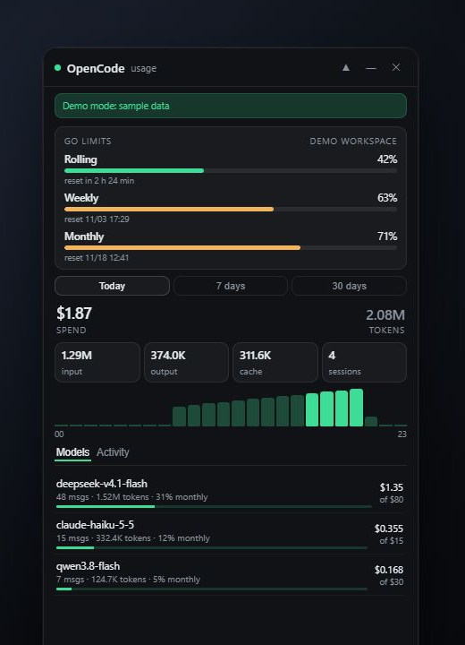
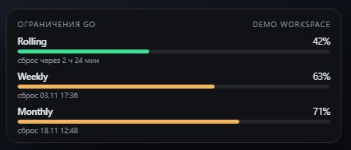

# OpenCode Monitor

[English](README.md) · **Русский**

Неофициальный оверлей для [OpenCode](https://opencode.ai): лимиты Go, расход, токены и активность — поверх всех окон и полностью локально.



> Проект не связан с OpenCode и не поддерживается им. Приложение читает локальную базу OpenCode и локальный CLI и не использует закрытые API.

[](https://github.com/Niki0zz/opencode-monitor/actions/workflows/ci.yml)
[](LICENSE)
[](#требования)

## Возможности

- **Лимиты Go** — Rolling (5 часов), Weekly и Monthly с процентами и временем сброса; данные берутся из локального CLI OpenCode.
- **Расход** — реальные списания, если OpenCode их записал, иначе оценка по редактируемому прайсу [`lib/pricing.json`](lib/pricing.json).
- **Токены** — вход, выход, reasoning, кеш и число сессий.
- **График** — по часам за сегодня или по дням за 7/30 дней.
- **Модели** — расход по моделям и доля месячного лимита каждой модели.
- **Активность** — последние сессии: время, модель, токены.
- **Мини-режим** — компактная карточка со всеми тремя лимитами Go, которую удобно держать в углу.
- **Уведомления о лимитах** — системное уведомление при 80% и 95%, один раз на окно лимита (переключается в трее).
- **Трей и горячая клавиша** — `Alt+Shift+O` показывает/скрывает окно; в установленной сборке есть автозапуск.
- **Интерфейс на русском и английском** — язык выбирается по системному.

### Мини-режим

В свёрнутом виде остаётся карточка лимитов Go; окно можно тянуть, а при наведении появляются кнопки «развернуть» и «скрыть».



## Приватность

- База OpenCode открывается **только для чтения**; приложение никогда в неё не пишет.
- **Нет телеметрии, аналитики, аккаунтов и облачной синхронизации.** Наружу не уходит ни один запрос.
- Интерфейс отдаёт **локальный HTTP-сервер** на случайном порту, доступный только с `127.0.0.1`. Каждый запрос к API требует одноразовый bearer-токен; проверяется заголовок `Host` (защита от DNS rebinding), CORS-заголовки не отдаются, разрешены только `GET`/`HEAD`, UI и API работают на одном origin.
- В исходном коде **нет идентификаторов workspace, организации или пользователя**. Ссылка на Console формируется во время работы из ответа локального CLI; `org_…` в репозитории не хранится.
- API не возвращает пути к базе, каталоги проектов и ID сессий.
- В настройках хранятся только геометрия окна, прозрачность, закрепление, мини-режим и переключатель уведомлений (`settings.json` в папке данных Electron).

Подробнее — [PRIVACY.md](PRIVACY.md). Об уязвимостях — [SECURITY.md](SECURITY.md), не через публичный issue.

## Требования

- Установленное приложение **OpenCode** с выполненным входом (лимиты Go требуют плана Go). CLI входит в состав десктопного приложения; отдельный `opencode` в `PATH` тоже подойдёт.
- **Windows 10/11** — основная и протестированная платформа. Сборки для macOS и Linux настроены, но автором не тестировались.
- **Node.js 22+** нужен только для запуска из исходников; в установленных сборках свой runtime.

## Установка

Скачайте последнюю сборку на странице [Releases](https://github.com/Niki0zz/opencode-monitor/releases).

Сборки пока не подписаны. На Windows SmartScreen может предупредить о неизвестном издателе — выберите **Подробнее → Выполнить всё равно**. На macOS откройте приложение через правый клик → **Открыть**.

### Из исходников

```bash
git clone https://github.com/Niki0zz/opencode-monitor.git
cd opencode-monitor
npm install
npm start
```

`npm run demo` запускает приложение с тестовыми данными — удобно посмотреть интерфейс без OpenCode. `start.vbs` — ярлык-запускатор для Windows из исходников.

## Управление

| Элемент | Действие |
| --- | --- |
| `▲` | Поверх всех окон (включено по умолчанию) |
| `—` | Мини-режим (только карточка лимитов) |
| `⤢` (при наведении в мини-режиме) | Вернуться к полному окну |
| `✕` | Скрыть в трей |
| `Alt+Shift+O` | Показать/скрыть из любого места |
| Двойной клик по трею | Показать окно |
| Трей → «Уведомления о лимитах» | Включить/выключить оповещения 80% / 95% |
| `Console ↗` | Открыть страницу активности OpenCode в браузере |

Позиция и размер окна сохраняются. Заголовок можно тянуть, размер — менять за край.

## Настройки

| Переменная | По умолчанию | Назначение |
| --- | --- | --- |
| `OPENCODE_DB` | `~/.local/share/opencode/opencode.db` | Путь к базе OpenCode |
| `OPENCODE_CLI` | определяется автоматически | Путь к `opencode` / `opencode-cli` |
| `MONITOR_PORT` | случайный свободный порт | Фиксированный порт локального сервера (для отладки) |

Прайс и месячные лимиты моделей — в [`lib/pricing.json`](lib/pricing.json). Если модели нет в файле, расход берётся из записей OpenCode, а полоса лимита скрывается.

## Как это устроено

- `main.js` — Electron: окно, трей, горячая клавиша, IPC.
- `collector.js` — локальный сервер, SQL-агрегаты, лимиты через CLI, раздача UI.
- `lib/usage.js` — чистые функции прайса, диапазонов и временных корзин (покрыты тестами).
- `ui/` — интерфейс на чистом HTML/CSS/JS без зависимостей, с русским и английским языками.

Коллектор запускается дочерним процессом на встроенном Node из Electron (`ELECTRON_RUN_AS_NODE=1`), поэтому установленной сборке не нужен внешний Node.js. Готовый порт он печатает в stdout, откуда его забирает main-процесс.

## Разработка

```bash
npm install
npm run check   # проверка синтаксиса и JSON
npm test        # unit-тесты на node:test
npm run demo    # интерфейс с тестовыми данными
npm run dist    # установщики для текущей платформы (electron-builder)
```

Правила кода и работы с тестовыми данными — в [CONTRIBUTING.md](CONTRIBUTING.md).

## Если что-то не работает

**«База OpenCode не найдена».** Запустите OpenCode хотя бы раз или укажите `OPENCODE_DB`. Стандартный путь: `~/.local/share/opencode/opencode.db`.

**Лимиты Go показывают «нет данных».** Монитор не нашёл или не смог запустить CLI. Проверьте, что приложение OpenCode установлено, или задайте `OPENCODE_CLI`. Команда `opencode api get /api/experimental/usage/limits` должна возвращать JSON.

**Окно не появляется.** Возможно, оно свёрнуто в трей: двойной клик по иконке или `Alt+Shift+O`. Одновременно может работать только один экземпляр.

**Порт из `MONITOR_PORT` занят.** Уберите переменную — приложение выберет свободный порт.

## Планы

- Подписанные сборки и автообновление.
- Разбивка по проектам и агентам, экспорт в CSV.
- Обновление прайса из каталога моделей.
- Другие языки интерфейса.

## Участие

Issues и pull requests приветствуются. Сначала прочитайте [CONTRIBUTING.md](CONTRIBUTING.md) и [CODE_OF_CONDUCT.md](CODE_OF_CONDUCT.md). Об уязвимостях сообщайте по [SECURITY.md](SECURITY.md), а не в публичный issue.

## Лицензия

[MIT](LICENSE) © 2026 TitoV3D
